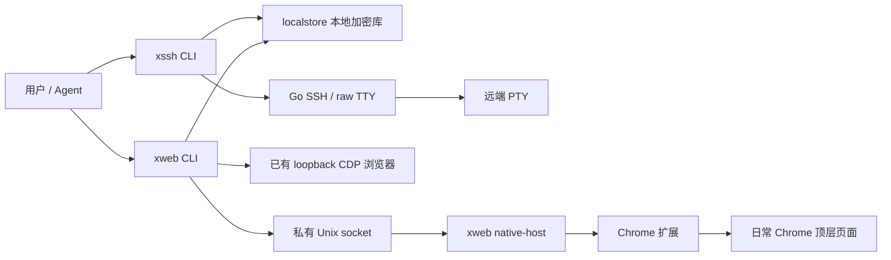

# x-gateway 当前架构设计

本文面向维护者，说明当前实现的组件、数据流、身份选择和安全边界。安装、命令示例及日常操作见 [README](../../README.md)，Chrome 接入细节见 [扩展说明](../../extension/README.md)。

## 产品范围与运行模型

x-gateway 提供两个 Go CLI：`xssh` 使用保存的凭据打开标准交互 SSH 终端；`xweb` 使用保存的网站账号，在选定浏览器页面按本次 CSS selector 填写用户名或密码，默认不提交。项目使用 Go 1.25+，交互终端支持 macOS 和 Linux；Node.js 用于扩展测试。

两个工具直接访问同一份本地加密库，使用自动生成的本机 key 加密持久化凭据。凭据和 SSH 主机 key pin 持久化到磁盘；SSH 连接、浏览器操作和待处理请求只属于当前进程或连接，不跨进程恢复或重放。

日常 Chrome 模式有一个由 Chrome 启动的 `xweb native-host` 进程：它在 Native Messaging 连接存续期间维护标签页库存并提供本地 IPC，断开后退出。已有 CDP 模式由本次 CLI 直接连接浏览器。两种模式均使用现有浏览器页面，不负责启动浏览器。

产品入口为 `xssh` 和 `xweb`。Native Messaging host 名 `com.x_gateway.accessctl` 用于 Chrome 连接配置；技能目录 `accessctl-ssh`、`accessctl-web` 分别提供两个工具的 Agent 操作约束。这些名称是稳定安装标识。

## 组件与数据流

| 组件 | 职责 |
| --- | --- |
| [`cmd/xssh`](../../cmd/xssh/main.go) | SSH CLI、账号与端口查找、终端生命周期和退出码 |
| [`cmd/xweb`](../../cmd/xweb/main.go) | fill/targets CLI、浏览器传输选择、Native Messaging host 和 manifest 入口 |
| [`internal/credentialcli`](../../internal/credentialcli/cli.go) | 两个工具共用的隐藏录入、受控 stdin、CRUD 与整库轮换入口；仅输出元数据 |
| [`internal/localstore`](../../internal/localstore/store.go) | 加密持久化、文件锁、身份规范化、账号选择与原子更新 |
| [`internal/terminal`](../../internal/terminal/ssh.go) | Go SSH 认证、TOFU pin、远端 PTY、本地 raw TTY 和窗口同步 |
| [`internal/webfill`](../../internal/webfill/fill.go) | 统一的 origin/document 校验、字段预检、填写及可选单次点击；Native Messaging 与 CDP 传输 |
| [`extension`](../../extension/README.md) | Chrome 连接与标签页库存同步、取消控制，以及顶层页面固定操作 |
| [`skills`](../../skills/) | Agent 录入和使用凭据的操作约束，不构成操作系统隔离机制 |

## 共享凭据库

### 文件与并发

ROOT 默认为 `os.UserConfigDir()/x-gateway`，`--data-dir ROOT` 替换该根目录。ROOT 和 `ROOT/simple/` 为私有目录，文件布局如下：

| 路径 | 内容与权限 |
| --- | --- |
| `simple/machine.key` | 自动生成的 32 字节随机本机 key，0600 |
| `simple/credentials.json` | 版本为 2 的密文文档：加密 keyring 和逐条加密记录，0600 |
| `simple/.lock` | 稳定文件锁，0600；覆盖重新加载、选择、修改和发布全过程 |
| `simple/known_hosts/` | `xssh` 的公开 SSH 主机 key pin，目录 0700、文件 0600；独立于凭据密文 |

每次操作取得独占文件锁并加载磁盘最新版本，避免并发进程覆盖其他账号。写入在同目录创建 0600 临时文件，完成写入和 sync 后原子 rename；不会发布部分更新。网站删除在同一把锁内完成账号选择、删除和保存，并返回实际删除账号的元数据。

### 加密、轮换与备份边界

内嵌 seed 用作 HMAC-SHA256 派生域，与本机随机 key 派生包装 key。随机 32 字节数据 key（DEK）使用 AES-GCM 加密每条记录；DEK 与 key ID 组成 keyring，再由包装 key 使用 AES-GCM 加密。每个密文使用独立随机 nonce，关联数据绑定 `simple/v2` 域、记录 ID 和 key ID。

`xssh credential rotate` 和 `xweb credential rotate` 调用同一整库轮换：在锁内生成新 DEK 和 key ID，重加密所有 SSH、Web 记录及 keyring，一次性发布完整文档。轮换不修改 `machine.key`、远端账号密码或主机 key pin；失败保留原磁盘版本。

文件加密防止凭据意外明文落盘，CLI 无 read/export 明文入口；同一 OS 用户仍可读取本机 key 并自行解密。内嵌 seed 不是秘密，技能约束也不抵御同用户任意代码执行。操作中工具需要解密凭据到进程内存，网页填写还会把值送入页面。

备份须包含整个 `ROOT/simple/`。已有密文但 `machine.key` 丢失时返回 `MACHINE_KEY_MISSING`，不生成替代 key 或覆盖旧库。单独保存密文无法在 key 丢失后恢复；权限异常、损坏或认证失败会拒绝读取。

### 身份、更新与公开结果

SSH 记录按账号、规范主机和有效端口定位，目标形式为 `user@host:port`，IPv6 主机加括号。默认端口与显式 22 是同一身份；内部 `Port=0` 表示未显式指定，实际端口仍为 22。网站记录按 `NAME + username` 定位，用户名保留大小写；ID 使用结构化 tuple 编码后取 SHA256，避免字符串拼接碰撞。同一 NAME 的所有账号必须属于同一规范 origin，否则返回 `CREDENTIAL_ORIGIN_CONFLICT`。

再次 add 同一身份会完整替换记录，未提供的秘密字段不会从旧记录补齐。网站 add/list/delete 的成功结果仅含 `name`、`origin`、`username`；SSH list 输出账号、host、可选 port 等元数据，add/delete 输出操作元数据。公开结果不含密码、私钥及解密口令。

`simple` v2 文档支持按类型和 Target 生成的记录 ID，以及网站按类型、Target、username tuple 生成的记录 ID。读取时先按文档中的 ID 和关联数据认证解密，再在内存中规范化：网站身份包含 username，SSH 未显式存储的非默认端口从 Target 读取。只读操作不改盘；写入或轮换按规范化后的记录 ID 与关联数据重新加密整份文档并原子发布，不更换 `machine.key`。

## 受控录入

人工录入要求真实 TTY，以关闭回显的方式读取秘密。Agent 使用 `credential add ... --stdin`：TTY 先关闭回显并输出 ready，再读取单行 JSON；管道读取完整 JSON。输入上限为 1 MiB，普通文件重定向、未知字段、多余 JSON 和取消均被拒绝，错误不回显原始输入。

网站 JSON 只允许非空 `username`、`password`。SSH username 来自 `user@host`，JSON 中提供时必须一致；允许 `password`、`private_key`、`passphrase`、`enable_password`、`sudo_password`。至少有密码或有效私钥，私钥上限 128 KiB；当前 SSH 连接使用密码或私钥认证，不使用 ssh-agent，也不自动执行 enable/sudo。

秘密不应进入 argv、环境变量、shell 字符串、明文临时文件或日志。用户首次主动提供给 Agent 的内容会经过聊天上下文；后续工具直接从库内取值。具体录入步骤见 [README 凭据保存](../../README.md#凭据保存与本地文件)。

## 账号与地址选择

### SSH

连接允许 `[user@]host`：先按主机及明确端口筛选，再按账号选择。唯一匹配复用保存的账号与端口；多个账号返回 `CREDENTIAL_AMBIGUOUS`，列出排序去重的用户名并要求 `user@host`；单账号多个端口列出数值排序端口并要求 `-p PORT`。明确账号未命中即失败，不回退到其他账号，也不偏好 22。

新增和删除必须给 `user@host`。新增省略端口登记 22；连接或删除省略端口则选择该账号唯一已存端口，存在多个端口时拒绝猜选。显式 `-p` 与地址内嵌端口须一致。裸 IPv6 作为完整主机解析，内嵌端口使用 `[IPv6]:PORT`。实现见 [目标规范化](../../internal/localstore/normalize.go) 和 [账号选择](../../internal/localstore/store.go)。

### 网站

fill 支持 NAME、HTTP(S) URL 或主机/IP，按以下顺序选择：

1. 显式 HTTP(S) URL、合法 IP（含端口或 IPv6）优先按地址查找，即使存在同字符串 NAME。
2. 普通文本或域名先精确匹配 NAME，未命中再按 host 查找。
3. URL 按规范 origin 匹配，忽略路径、查询和片段；主机名与 IP 规范化，端口按数值处理，HTTP 80、HTTPS 443 归一。裸 host 不猜协议，显式 host 端口用于筛选。
4. 裸 host 匹配多个 origin 时要求完整 URL，不通过 `--user` 推断协议或端口。选定 origin 后，唯一账号自动使用；多账号要求大小写精确的 `--user USER`，错误用户名不回退。
5. 同 origin、同 username 在多个 NAME 下重复保存时，要求具体名称加 `--exact-name`。此选项仅用于 fill，强制精确名称查找，也可选择名称恰好像 IP/URL 的记录。

歧义提示列出排序的用户名、origin 或名称，歧义时不填写或删除。网站 add/delete 按精确 NAME 管理，delete 多账号时必须用 `--user`；地址查找只用于 fill，不扩大删除范围。选择结果始终携带记录的完整 origin，不放宽注入边界。实现见 [网站解析](../../internal/localstore/webresolve.go)。

## SSH 终端

`xssh` 解析并读取选定凭据后，使用 Go SSH 直接连接远端，申请 PTY 并启动交互 shell。TCP、握手和启动阶段有 15 秒截止时间及取消；成功后的连接由原进程 context 管理。每个进程持有自己的 SSH 连接，退出即释放，下次调用新建连接。

本地 stdin 必须是真实 TTY；进入 raw 模式后输入输出按原始字节透传，保留 ANSI、UTF-8 和控制字符。Ctrl-C 作为远端输入，SIGWINCH 同步窗口大小。远端 exit-status 作为 CLI 退出码，断开且无退出状态返回 255。返回、失败或取消路径恢复本地终端，输入轮询支持取消，避免留下阻塞 stdin 的读取任务。终端输出可能包含远端显示的敏感信息，工具不做脱敏或命令包装。

首次连接自动 TOFU：按主机和端口计算 pin 文件名，完整写入后以无覆盖方式发布，并输出 SHA256 指纹及未经独立核验提示。不同账号共享同一地址的 pin。后续主机 key 变化返回 `HOST_KEY_CHANGED` 并停止；须独立核验，不能自动覆盖、删除 pin 或更换数据目录绕过。删除凭据和轮换 key 均不删除 pin。实现见 [主机 key 校验](../../internal/terminal/hostkey.go) 与 [TTY](../../internal/terminal/tty_unix.go)。

## 网页填写

### 统一操作边界

每次 fill 至少指定用户名或密码 selector 之一，可分次处理多步表单；不存储 selector、登录流程或成功条件。操作先获取当前 URL 与 document 身份并核验登记 origin，再预检本次全部凭据字段。每次 fill/click 在页面端再次检查同 URL、同 document，导航后拒绝失效操作。

selector 沿用 `querySelector` 首匹配语义；填值仅支持顶层 `input`/`textarea`，要求存在、可见、未禁用且非只读。使用原生 setter，派发 input/change。默认只填写；显式 submit selector 时，在填后最多等待一秒让按钮可用，最多点击一次。

返回 `target_id`、`filled`、`submitted`，不返回注入值，也不表示登录成功。Agent 或用户继续观察页面并处理后续步骤。字段不会在操作后清空或遮罩；页面脚本和有页面控制权限的客户端可以读取值。失败或取消可能已留下部分填值，已发出的请求不能撤回。当前操作只覆盖顶层页面字段，不提供通用 iframe、Shadow DOM、SSO 弹窗或验证码/MFA 自动处理。

### 日常 Chrome：Native Messaging

扩展为 Manifest V3、版本 0.3.0，最低 Chrome 105；权限为 `nativeMessaging`、`scripting`、`storage`、`alarms` 及 HTTP/HTTPS 全站权限。扩展按 profile 自动连接 Native Messaging、同步 HTTP/HTTPS 非 incognito 标签页，无需为每个 tab 点击 popup。popup 用于查看连接/权限状态和重新连接。

Chrome 根据 manifest 启动 `ROOT/xweb-native-host.sh`，shim 用绝对路径启动 `xweb native-host`；manifest 的 allowed_origins 仅允许指定扩展 ID。host 在 `/tmp/xweb-UID-DATADIRHASH/` 提供私有短 Unix socket（目录 0700、socket 0600），路径与用户和规范数据目录绑定，避免长 ROOT 超出 Unix socket 路径限制。

`targets` 聚合当前连接的标签页，只返回 origin 和身份元数据，不返回标题、路径、查询或认证值。fill 必须使用当次返回的完整不透明 target_id，其中包含随机连接身份和 tab ID。连接更换后此前的 ID 失效，须重新查询。

host 使用固定 `current`、`visible`、`fill`、`click` 操作及取消控制；同一 tab 同时填写返回 `TARGET_BUSY`。扩展按 tab 串行执行带截止时间的操作，取消、tab 关闭或断连会终止待处理操作并释放排队值；自动重新连接只恢复发现，不重放填写或点击。Native Messaging 断开后 host 关闭客户端、退出并移除自己的 socket。实现见 [桥接](../../internal/webfill/bridge.go)、[扩展后台](../../extension/background.js) 和 [页面操作](../../extension/page.js)。

### 已有 CDP

`--cdp` 接受 loopback HTTP 或 WebSocket endpoint。HTTP 入口通过 `/json/version` 获取并校验浏览器 WebSocket；只连接已有 browser endpoint 与页面。指定 target 时校验该页面 origin；未指定时必须只有一个页面匹配凭据 origin，否则返回 `TARGET_AMBIGUOUS`。

本次操作 attach 到已有 target，结束时 detach 自己的会话并关闭自己的 CDP 连接，不关闭浏览器。页面操作沿用上述 origin/document 约束。实现见 [CDP 页面操作](../../internal/webfill/cdp.go) 与 [传输](../../internal/webfill/cdp_transport.go)。

## 安装与卸载边界

[`install.sh`](../../install.sh) 构建并安装 `xssh`/`xweb`、两份通用技能和必要的 zsh/bash PATH 配置，不初始化或轮换凭据，不安装常驻服务。macOS 默认配置 Chrome；Linux 按当前会话 `DISPLAY`/`WAYLAND_DISPLAY` 判断：两者均为空时采用 headless，跳过扩展复制、shim/manifest 及 ID 交互，无 TTY 也可完成，`xweb` 仍可连接已有 CDP。headless 不删除之前的 Chrome 文件；显式 `--extension-id ID` 强制配置 Chrome，可用于远程预配置。浏览器加载扩展及更新后重新加载仍由用户完成。

[`uninstall.sh`](../../uninstall.sh) 无需 Go，按固定安装路径清理工具、技能、扩展、当前平台 manifest 和默认 ROOT 下的 shim；无 GUI 会话也清理 Chrome 残留，叶子符号链接只移除链接。脚本保留凭据、本机 key、主机 pin、其他用户数据、共享 PATH 与父目录，可重复运行，不提供 purge。Chrome 已加载的扩展条目由用户手动移除，脚本不改浏览器 profile 或终止现有 SSH/浏览器会话。具体目录与操作见 [README 安装](../../README.md#一键安装) 和 [卸载](../../README.md#一键卸载)。

## 测试与验证范围

[`Makefile`](../../Makefile) 的 `make test` 执行 `go test -race ./...` 和 `node --test extension/*.test.js`；`make vet` 执行全部 Go 包的静态检查。当前自动测试覆盖：

- 存储与 CLI：加密和权限、整库轮换、缺失 key/损坏密文、原子写失败、并发进程写入、simple 记录身份读取与规范化、多账号 CRUD、账号/端口/IPv6 选择、地址与名称优先级、歧义不操作、严格输入与元数据输出、帮助入口。
- SSH 假服务与输入管道：远端 PTY、原始字节和控制字符、窗口变化、退出码、断连与取消、再次连接、TOFU 并发首次 pin、主机 key 变化和符号链接拒绝、非 TTY 拒绝。
- 网页与扩展模拟：字段预检、单/双字段、默认不提交、显式点击一次、origin/document 约束、库存和失效 target、取消与断连不重放、扩展自动连接和退避、权限状态。
- 安装卸载隔离测试：参数与帮助、GUI/headless 分支、通用技能路径、原子安装失败、PATH 幂等、临时目录清理、固定清理范围、符号链接和数据保留。

真实本地 TTY 的关闭回显与恢复、Chrome Native Messaging/CDP 接入及实际 DOM 事件属于独立集成验收范围；上述模拟测试不能替代真实终端和浏览器验证。可使用 [SSH fixture](../../scripts/simple-ssh-fixture/README.md) 与 [网页 fixture](../../scripts/simple-web-fixture/main.go) 在隔离目录中用公开假凭据验收。网页 fixture 包含多步表单、input/change、用户名事件替换密码 DOM、填后启用按钮和只返回计数的状态端点。通用测试与设计不依赖真实设备或生产凭据，也不保证任意网站登录。
